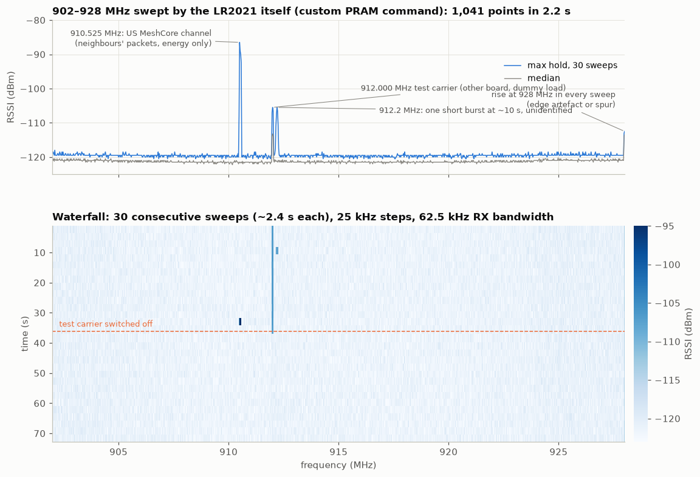
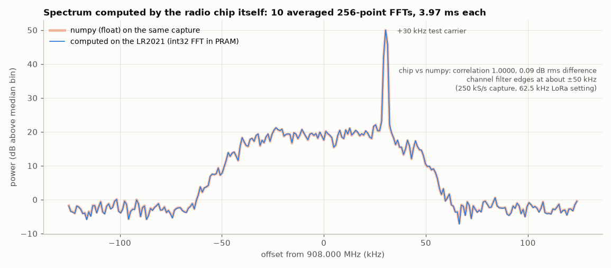
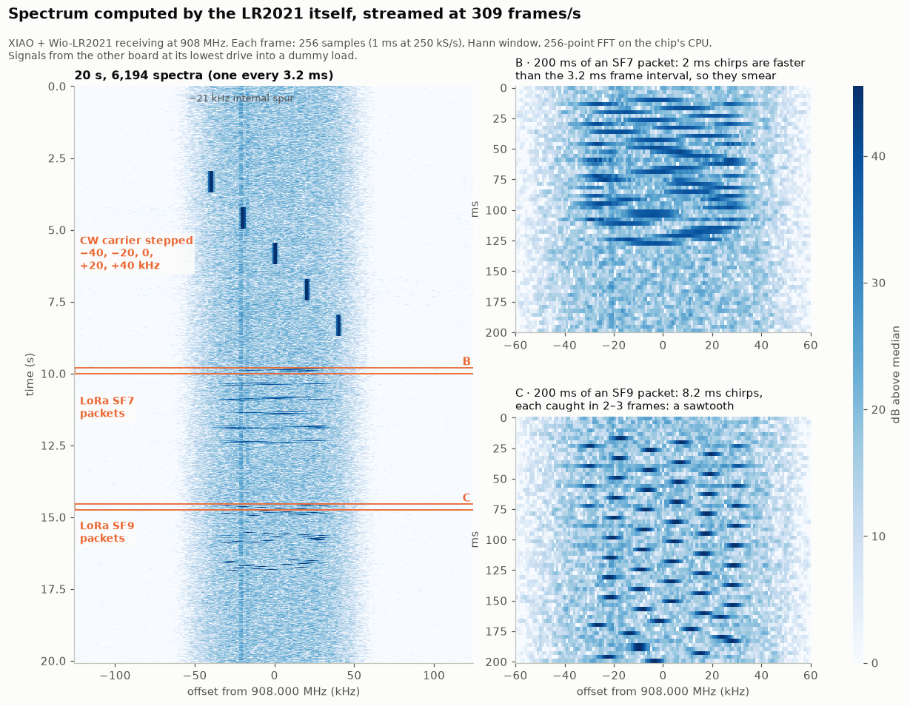

# Custom commands in PRAM [HW]

The LR2021 runs its own code from the 4 KB Patch RAM. Semtech's patch normally lives there, but
RadioLib (and this repo's firmware) never loads it, so on these boards all of PRAM is free. A
blob with the right header becomes a set of new host commands, reached through ActivatePram
(0x012D). Source: `firmware/pram/` (`sweep.S`: header, entry table, sweep; `fft.c`: FFT;
`bench.S`: CPU benchmarks). Host tool: `tools/pram.py`.

A second blob, `scan.bin`, turns the chip into a multi-channel LoRa receiver: see
[pram-scanner.md](pram-scanner.md).

This page covers the commands themselves. **How the CPU and PRAM work** is in
[lr2021-cpu.md](lr2021-cpu.md): the blob format and calling convention, registers, timing,
memory, the DMA rules, the toolchain and the GCC patch, and what hangs the chip.

## Spectrum sweep (entry 1)

Parameters, big-endian: start Hz (4), step Hz (4, signed), points (2, ≤ 448), dwell (2),
readings to average (2). For each point the chip retunes (the radio stays in continuous RX),
waits dwell × 16 loop iterations, sums the instant-RSSI readings and stores the u16 sum at
0x101C80 + 2·i. It returns the number of points as 2 bytes. Retuning in RX works: SetRfFrequency
is accepted mid-RX and RSSI follows the new frequency.

- **Settling:** the RSSI lags a retune. With 62.5 kHz RX bandwidth a dwell below ~1000
  (≈ 1.4 ms) still reads the previous frequency.
- **Speed:** 902–928 MHz in 25 kHz steps (1,041 points), dwell 1000, 4 readings averaged:
  **2.2 s including the readback**; on the chip 100 points take 203 ms (~2 ms per point).
  Floor about −121 dBm.

```
python3 tools/pram.py load                       # after "set radio 908,62.5,7,5" in the console
python3 tools/pram.py sweep 902 928 25 --out band.csv --plot band.png
```



The waterfall (30 sweeps, ~70 s) shows the test carrier at 912 MHz from the other board
(switched off half-way), bursts on the US MeshCore channel at 910.525 MHz (other people's
packets, energy only, nothing decoded), one unidentified burst at 912.2 MHz, and a rise at
928 MHz present in every sweep.

## On-chip FFT and live waterfall (entries 7–10, `fft.c`)

The chip captures raw IQ (source 0, int8 I/Q at 250 kS/s with the 62.5 kHz LoRa setting, 1–10
segments of 256 samples into 0x804000), computes windowed 256-point FFTs, and returns the
spectrum. The console's `wfrun` repeats that and streams binary frames to the PC.

| Entry | Does |
|---|---|
| 7 | FFT of a capture the host already ran; params `nseg skip`; 256 × u64 power at 0x805400 (used by `fft --check`) |
| 8 | (retired: capture only, debug) |
| 9 | **capture + FFT + dB**; params `nseg [overlap]`; 256 × u8 half-dB at 0x807B00 (bin 0 = DC, 128–255 negative). `nseg` 0 stops an overlapped capture |
| 10 | timing benchmarks (below) |

### Results

| Segments averaged | Chip time per frame | Streamed frames/s (`wfrun`) |
|---|---|---|
| 1 | 2.73 ms | **317** |
| 2 | 5.22 ms | 177 |
| 4 | 9.85 ms | 97 |
| 10 | 23.7 ms | 41 |
| 1, overlapped (`--overlap`) | 1.72 ms | **464** |

Per frame outside the chip: SPI readback 0.34 ms, USB 0.09 ms. Against numpy on the same capture
(`tools/pram.py fft --check`): same peak bin, correlation 1.0000, 0.05 dB rms difference.





A 20 s capture at 462 frames/s (`waterfall --nseg 1 --overlap`, 9,273 spectra): every spectrum
was computed on the chip. The other board (lowest drive, dummy load) stepped a CW carrier through
−40, −20, 0, +20 and +40 kHz, then sent LoRa SF7 and SF9 packets (62.5 kHz).

- Zoom B: a frame comes every 2.16 ms and an SF7 chirp every 2.05 ms. Each frame catches the
  sweep 0.12 ms (3.5 kHz) further on, so the preamble's upchirps alias into slow slanted streaks,
  a full sweep about every 40 ms.
- Zoom C: each 8.2 ms SF9 chirp spans about 4 frames and shows as a staircase of ~16 kHz steps.
- Also visible: the steady internal spur at −21 kHz and the ±50 kHz channel-filter edges.

```
python3 tools/pram.py waterfall --seconds 20 --nseg 1 --overlap --save wf.npz --plot wf.png   # 464 frames/s
python3 tools/pram.py waterfall --seconds 20 --nseg 4 --save wf.npz --plot wf.png             # 4 segments averaged
python3 tools/pram.py fft --frames 5 --check --plot spectrum.png
```

### How it got from 6.6 to 464 frames/s

| Step | Effect |
|---|---|
| Capture driven from inside the command (ROM handlers 0x0290 0xF9A0, SetRx 0xFCFC, pointer 0x5B44, SetFs 0xEB40) | one command per frame. **The capture DMA runs while our code holds the CPU** |
| End each capture in FS instead of standby | SetRx from FS takes 0.19 ms, from standby 1.27 ms (synthesizer lock) |
| Capture only the segments used | 1 segment = 1.02 ms of samples instead of 10.2 ms |
| `wfrun`: frames looped on the MCU and streamed as binary | no host round trips or hex text |
| Raw 16 MHz SPI for the command and the readback | readback 1.73 → 0.34 ms |
| 16-bit block-floating-point FFT (no 64-bit maths) | 3.8 → 2.3 ms per FFT |
| Butterfly stages 3–8 in hand-written assembly | GCC spilled registers to the stack (only 16 exist) |
| Back to C with a patched GCC (blink allocatable) and the ARC700 pipeline model | 1.29 → 1.21 ms per FFT, faster than the assembly ([details](lr2021-cpu.md#the-gcc-patch-blink-as-a-13th-register)) |
| Load, window and stages 1–2 fused into one radix-4 pass | saves a pass over memory and most of the bit reversal |
| Twiddles built in RAM from a 65-entry quarter-wave table | frees ~380 B of PRAM; RAM reads are also faster than PRAM reads |
| dB straight from 32-bit power for 1 segment | skips the u64 accumulators |
| Overlap: start the next capture as soon as the windowed load has copied the samples out | 2.73 → 1.72 ms per frame (below) |

**FFT precision:** block floating point. Windowed input is ≤ 2¹⁴ per component, a radix-2 stage
at most doubles the magnitude, so the plan (from the input's largest raw sample) runs stages
unscaled while the worst-case bound stays ≤ 8192 per component and halves them after that.
Magnitudes stay ≤ 2^14.5, so s16 storage, Q15 twiddle products and their sums fit in 32 bits;
the scale exponent is folded back into the power.

### Overlapped capture (entry 9 with `overlap` = 1)

A frame used to be: capture (SetRx 0.19 ms + 1.02 ms of samples, CPU waiting), then FFT and dB
(1.4 ms, receiver off). The capture DMA works while our code runs, and only the max pre-pass and
the windowed load read the capture. So with `overlap` set, entry 9:

1. waits for the capture the previous call started (normally already complete), stops it, goes
   to FS;
2. runs the max pre-pass and the windowed load from 0x804000 into the work buffer at 0x807C00;
3. starts the next capture (SetRx from FS);
4. runs stages 3–8 and the dB conversion, writes the result at 0x807B00 and returns, leaving
   the capture running through the host's readback and the next command.

The work buffer and the result were moved out of the capture bank (0x804000–0x805FFF) for this:
the CPU and the host only touch 0x807xxx while the DMA owns the bank, and nothing stalls. With a
carrier from the other board at +20 kHz, normal and overlapped mode agree: peak in the same bin in
every frame, same level, same floor within one 0.5 dB step, no repeated frames.

- Only `nseg` 1. The u64 accumulators for `nseg` > 1 live in the capture bank.
- Before anything else touches 0x804000–0x805FFF (entry 7, a host capture), stop it with
  `nseg` 0. `wfrun … 1` does that when it ends.
- The capture only starts on SetRx from FS. Re-arming 0x0290 while the receiver keeps running,
  or SetRx again while in RX, doesn't start it (the command then waits for a capture that never
  comes), so the SetFs/SetRx pair per frame stays.
- The command is now compute-bound: windowed load ~0.25 ms, SetRx 0.19 ms, stages 3–8 ~1 ms,
  dB ~0.1 ms.

```
python3 tools/pram.py waterfall --seconds 20 --nseg 1 --overlap --save wf.npz --plot wf.png
```

### CPU timing (entry 10)

`rc 012D 0 0A <mode>` runs a benchmark; time it with the console's `us=`. Mode 0: 10⁶ one-cycle
loop iterations (the CPU clock, 32.1 MHz); 4: ten full FFTs; 16–22: one instruction type each.
Results: [lr2021-cpu.md](lr2021-cpu.md#timing-hw).

A radix-2 butterfly (4 multiplies, 4 loads, 4 stores, ~12 ALU ops) costs 36–40 cycles. A full
256-point FFT is ~39k cycles (1.21 ms): ~2.6k for the max pre-pass, ~5k for the fused
load/window/radix-4 pass, the rest in stages 3–8.

### RAM used

| Range | Use |
|---|---|
| 0x804000–0x8053FF | capture (up to 10 segments); the bank 0x804000–0x805FFF is the DMA's while a capture runs |
| 0x805400–0x805BFF | u64 power sums (entry 7, entry 9 with `nseg` > 1) |
| 0x807800–0x807A03 | twiddle table (built on first use) and its marker word |
| 0x807B00–0x807BFF | entry 9 result: 256 × u8 half-dB |
| 0x807C00–0x807FFF | FFT work buffer, 256 × {s16 re, s16 im} |

0x807800–0x807FFF sits above the stack (top 0x8077F8). Over a receive, a capture and FFTs it kept
its random power-up contents, while only 0x8076F8–0x8077BC changed, so nothing else seems to use
it. The FFT checks the marker and rebuilds the table if anything overwrote it.

## Other entries

| k | Name | What it does |
|---|---|---|
| 2 | hello | returns `LRC1`, the parameter length and the first parameter byte |
| 3–6, 8 | (retired) | debug entries used while building the sweep and the capture; now return 1 |
| 7, 9, 10 | fft, capfft, bench | see above |

## Build

`firmware/pram/build.sh` (patched ARC GCC in Docker, see
[lr2021-cpu.md](lr2021-cpu.md#toolchain)). The build fails if the image reaches the sweep buffer
at 0x101C80 or if anything lands in `.bss`. `pram.bin` is checked in, so `tools/pram.py` works
without Docker.
