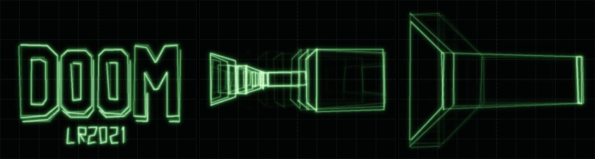

# A raycaster on the LR2021's CPU, drawn on a simulated oscilloscope [HW]

The chip runs a small first-person game and sends every frame as vector graphics over its own CW
carrier. An RTL-SDR receives it, and Python draws what arrives on a simulated XY oscilloscope.

The chip does all of the game:
- it holds the map and the player;
- it moves the player with the keys the host passes in, with wall collision;
- it casts the rays and turns the walls into a display list of beam moves;
- it sends that list by hopping its synthesizer.

The host passes in keys and draws the beam where the chip says. It renders nothing itself.



Video: [figures/raycaster_scope.mp4](figures/raycaster_scope.mp4). It shows the title screen, then a
walk through the map at about 68 frames/s, all decoded live from the RTL-SDR.

- Blob: `firmware/pram/ray.c` → `ray.bin` (2.7 KB of the 4 KB PRAM), built by `build_ray.sh`.
- Title screen: `gen_title.py` → `ray_title.h`.
- Host test build: `ray_sim.c` runs the same C on the PC and logs every synthesizer write.
- Receiver and scope: `tools/raycaster.py`.

## Where everything lives

Everything about the game is on the LR2021. The laptop sends key presses and draws the beam where
the radio says.

**On the chip**, in its PRAM (code memory), loaded once at start as `ray.bin`:

| What | In the source | In `ray.bin` (PRAM address) |
|---|---|---|
| The game code: movement, collision, ray casting, vectorizing, sending | `firmware/pram/ray.c` | 0x198 onward (0x101198, `ray_cmd`) |
| **The map**, 16 × 16 cells | `MAP[]` in `ray.c` | **0x8B0–0x9AF (0x1018B0)** |
| The sine table for the trigonometry | `SIN_Q[]` in `ray_sin.h` | 0x6AC (0x1016AC) |
| The title screen's beam points | `TITLE[]` in `ray_title.h` (made by `gen_title.py`) | 0x9B0 (0x1019B0) |

You can check the map is in the binary with `xxd -s 0x8b0 -l 256 -c 16 firmware/pram/ray.bin`: it
prints the grid, one row per line, `01` for walls. You can also read it back from the running chip
through the console after the blob is loaded: `mr 1018B0 32` and `mr 101930 32` (32 words each).

**On the chip**, in its RAM (state while running):

| What | Address |
|---|---|
| The player: x, y, angle, the carrier frequency | 0x807900 |
| The 160 ray results: heights and wall types | 0x807920, 0x807A60 |
| The frame's vector display list | 0x807B00 |

**Over SPI**, MCU → chip, per call:

| Direction | Bytes | Content |
|---|---|---|
| To the chip | 11 | op, keys held, frames to run, slot length, frequency step |
| From the chip | 10 | player x, y, angle, frames run, points in the last frame |

Once at start, the host also sends the start position and angle (op 0). The picture never crosses
SPI. It leaves the chip only as radio: the chip's synthesizer moves the carrier, an RTL-SDR in a
cookie tin receives it, and nothing else connects the two. The position the chip reports back is
used only by the demo's steering and the log line.

**On the laptop**, in `tools/raycaster.py`:
- **No map.** It never reads the chip's map; there is nothing to read it from.
- `START`: the start position, sent once.
- `ROUTE`: only for `demo`, a list of seven spots to walk to. Each call, the script turns toward the
  next spot using the position the chip just reported, and presses forward or turn. That is a
  scripted player pressing keys; whether the walk is possible, and what it looks like, is all the
  chip. `play` uses your keyboard instead.
- The receiver: FM demodulation, frame finding, calibration, slot reading.
- The scope simulation, which draws lines between the received points. Nothing more: no walls, no
  depth, no colours of its own.

**On the laptop, for testing only:** `ray_sim.c` compiles the same `ray.c` on the PC, and
`raycaster.py sim` runs it with a simulated radio link. That's how the decoder was developed
offline. The video and the bench numbers in this doc are all from the chip and the RTL-SDR, not the
simulator.

## On the chip

| Part | How |
|---|---|
| Map | 16 × 16 cells in the blob, loosely after the start of E1M1 |
| Player | position (8.8 fixed point, cells) and angle (1024 per turn) in RAM at 0x807900 |
| Movement | keys per call: forward, back, turn, strafe; sliding collision with a margin |
| Rendering | 160 rays (one per half screen unit), DDA on the grid, Q14 trig from a quarter-wave table, hardware `divu` |
| Vector list | one quad per run of one flat wall face: a flat wall's height changes at a constant rate across the screen, so a run ends where the wall type or side changes or the rate breaks (a corner, or a nearer wall). Corners use 16× finer heights, extended to the column edges |
| Title | the DOOM logo with a bevel, and "LR2021", as 105 beam points in PRAM |

The CPU renders a frame in about 1–2 ms at 32 MHz, then sends it.

## On the air

During CW (SetTxTestMode `0x020E 02`), the blob writes the synthesizer word `0xF40144` once per
slot, as the [waterfall text](pram-waterfall-text.md) blob does. The carrier moves within about
2 µs and settles in 15–20 µs. A slot is 80 µs, and the receiver averages its last 40%.

```
SYNC (while rendering) | MARK | [PEN] X Y [PEN] X Y ... | MARK | SYNC
```

| Level (× 1 kHz from the carrier) | Meaning |
|---|---|
| x − 80 | X, in half units (0–160 across the screen) |
| y | Y, in half units (−62..62, up is +) |
| −130 | PEN: the next point is a move, beam off |
| −220 / +220 | SYNC / MARK |

## Receiving

The RTL-SDR is tuned 400 kHz below the carrier and runs at 2.048 MS/s, with gain 40.2. The decoder
then does the following, in one pass over the samples:
1. FM-demodulates, and runs a 9-sample median to find SYNC and MARK.
2. Times each frame from its SYNC→MARK step. The 50% and 89% crossings give the PLL's settling time
   constant, and both frame edges are corrected by it.
3. Counts slots using the chip's real slot length. Each slot runs about 31 CPU cycles longer than
   the nominal 2560, from loop and register-write overhead.
4. Calibrates each frame on its own SYNC and MARK levels, which removes carrier drift.
5. Takes the median of each slot's settled part.

It needs 0.15 s of CPU per second of signal.

The scope simulation draws the beam along each segment with brightness falling as 1/length, bright
dots where it dwells, two-scale Gaussian glow, a saturating P31-green phosphor, persistence between
frames and a graticule.

| Measurement | Result |
|---|---|
| Frames decoded on the bench | 656 / 656 (NiceRF at −9 dBm drive into a dummy load, RTL-SDR in a cookie tin) |
| Title wobble, frame to frame | 0.39 screen units RMS (screen 80 wide), mean offset 0.07 |
| Simulated RF, 30 dB SNR | points within 0.13 units on average |

Things that mattered, in the order they turned up:
- **Sampling too early in the slot** pulled points toward their neighbours, because the PLL hadn't
  settled.
- **Per-slot overhead:** about 31 cycles per slot adds up to more than a slot over a frame, which
  made the slot count wrong.
- **Overshoot on big steps:** the synthesizer dips past the SYNC threshold for a moment, so the
  closing SYNC must hold for half a slot.
- **The RTL-SDR's gain:** wobble fell from 3 to 0.6 units between gain 10 and 40, because a weak
  signal sits in the low bits of the 8-bit ADC. Gain 49.6 is worse again. More transmit power didn't
  help.
- **The chip's own rendering:** whole-unit coordinates and outlines that split and merge as you move
  made the game look shaky even with a perfect link. Half units, exact corners and the
  constant-rate test for outline breaks fixed most of it.

## Usage

```
cd firmware/pram && ./build_ray.sh
python3 tools/raycaster.py demo --mp4 out.mp4    # title, then a walk along a waypoint route
python3 tools/raycaster.py play                  # a window: arrows/WASD move and turn, , . strafe
gcc -O2 -DHOST_SIM -o ray_sim firmware/pram/ray_sim.c
python3 tools/raycaster.py sim --sim-bin ./ray_sim --mp4 sim.mp4   # no radio
```

`play` isn't tested yet.
