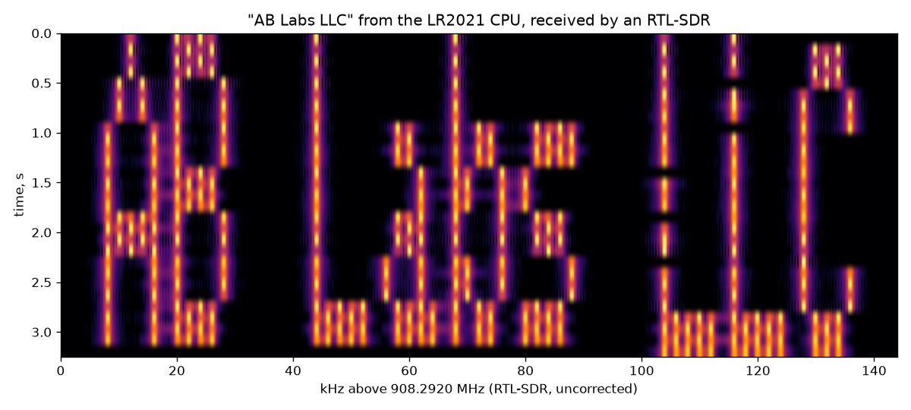

# Text on a waterfall from the LR2021's CPU

A PRAM blob (`firmware/pram/text.c`, `text.bin`, 1008 bytes with its font) writes any text across
frequency with the radio's CW carrier, so it reads on an SDR waterfall. It uses the same trick as
[pram-pll.md](pram-pll.md): while SetTxTestMode sends a carrier, the CPU writes the synthesizer
word 0xF40144 and the carrier moves within ~2 µs.



*"AB Labs LLC" from the XIAO board at −9 dBm, 908.3 MHz, received by an RTL-SDR on the bench
(4 ms Hann FFTs averaged over one pass).*

## How it draws

- **Font:** 5×7 ASCII 32–126 in PRAM (`font5x7.h`, from Adafruit-GFX's classic `glcdfont.c`, BSD
  license), one blank column between characters. Up to 64 characters.
- **One call = one scanline.** For each font row, the blob builds a bitmap of the lit pixels, then
  makes `passes` passes over the columns left to right. Each column gets `dwell` cycles: at
  `base + offset + x × spacing` if its pixel is lit, otherwise at the park frequency (the carrier
  itself, `base`). Every pixel therefore gets the same share of time and the same brightness.
  Blank columns between characters take no time.
- **The host** keys the carrier at the park frequency, calls rows 0–6 in turn (top row first) and
  ends with standby. A pass of "AB Labs LLC" is 55 columns × 2 ms = 110 ms; 4 passes per row make
  the text 3.1 s tall. The park carrier sits 300 kHz below the text, outside the picture.
- **Timing** is cycle-counted with interrupts off (32 MHz CPU in TX), like pll.c. Each call has to
  stay under the host's ~1 s BUSY limit, so the host sets the passes, and shortens the dwell for
  long text so one pass fits in a call.

Entry 1 params (big-endian): nchars (1), row 0–6 (1), passes (2), dwell in cycles (4), column
spacing (4, synthesizer word units: Hz × 2²⁰ / 10⁶), offset (4, signed, word units), flags (1,
optional; bit 0 mirrors left-right). Text: ASCII at 0x807800. Response: the base word (4). Entry 2
answers "TXT1".

## Running it

```
python3 tools/waterfall_text.py "AB Labs LLC" --png wf.png
python3 tools/waterfall_text.py "HELLO" --spacing 3 --row-ms 600 --mhz 915 --dbm 0
```

Options: `--offset` (kHz from carrier to the first column, default 300), `--spacing` (kHz per
column, default 2), `--dwell` (ms per pixel visit, default 2), `--row-ms` (time per font row,
default 400), `--mirror`, `--no-sdr`. With the SDR it tunes 150 kHz below the text, so the
RTL-SDR's DC spike stays out of the picture, records at 1.024 MS/s and saves the waterfall.

## What you see

- Each pixel is a 2 ms tone burst that comes back once per pass, so its spectrum is about
  1 kHz wide (sinc of the burst, with sidelobes). 2 kHz spacing keeps the columns apart.
- The rows show seams a few ms long, where the host's round trip between calls leaves the
  carrier parked.
- When the carrier is switched off, the PA makes a broadband click about 0.5 s after the text;
  the script crops it out of the picture.
- Text is written top row first. In waterfalls that scroll down (newest line on top, e.g. gqrx),
  it appears upside down; flip the row order in the script if you want it upright there.
