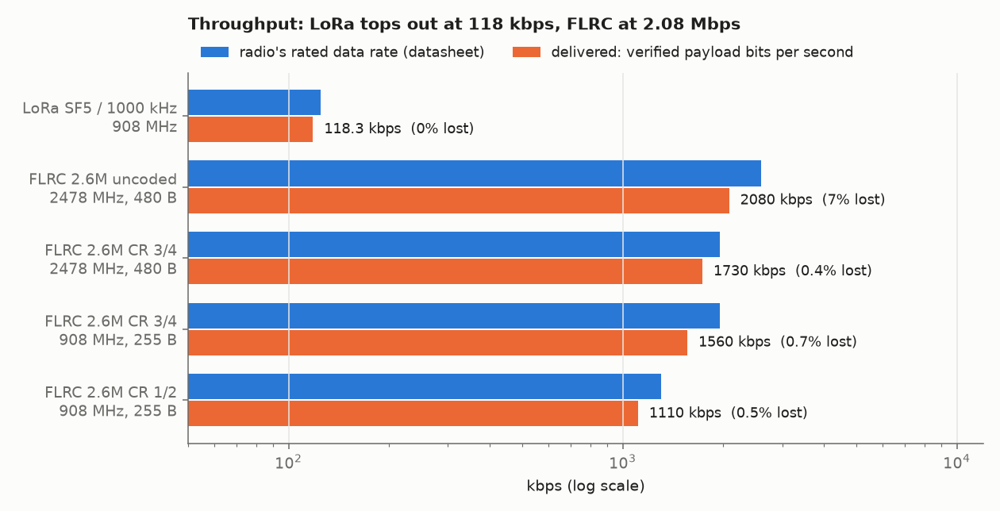
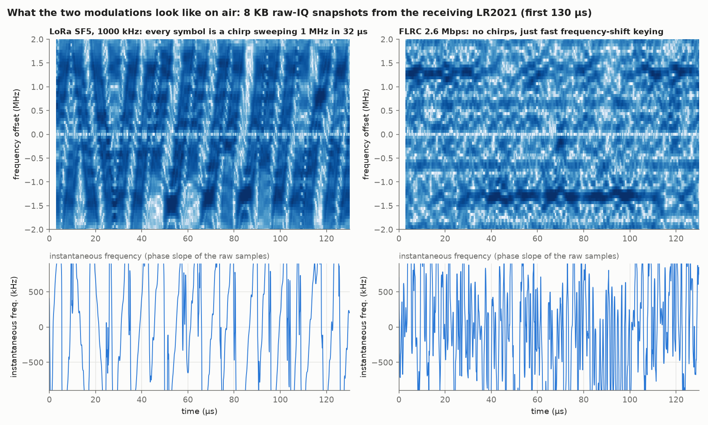
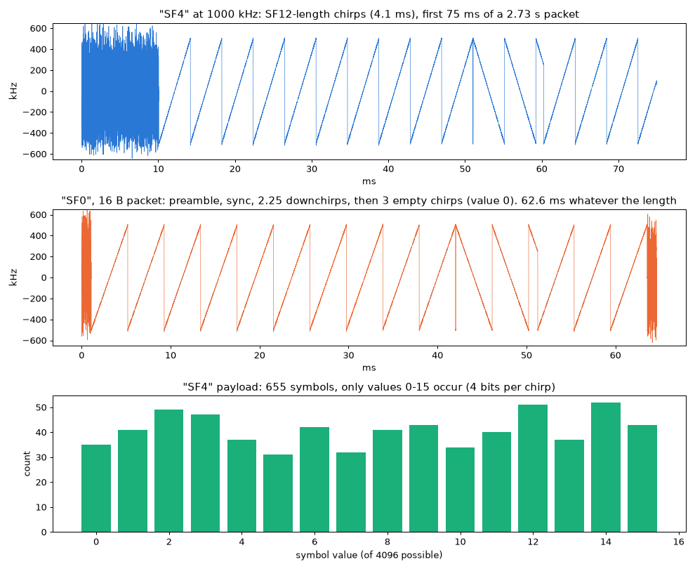
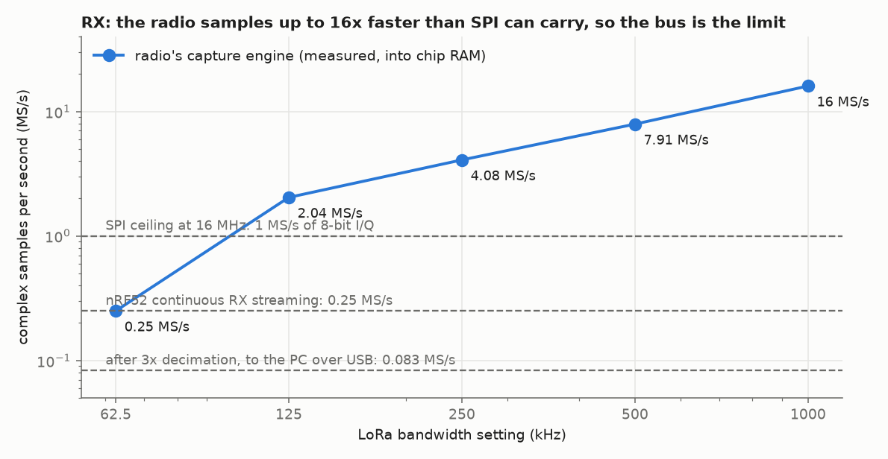
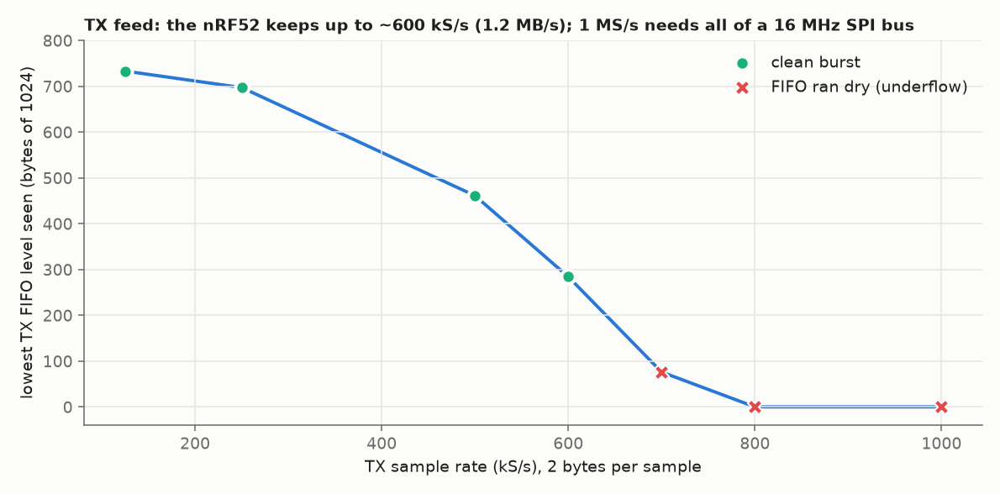
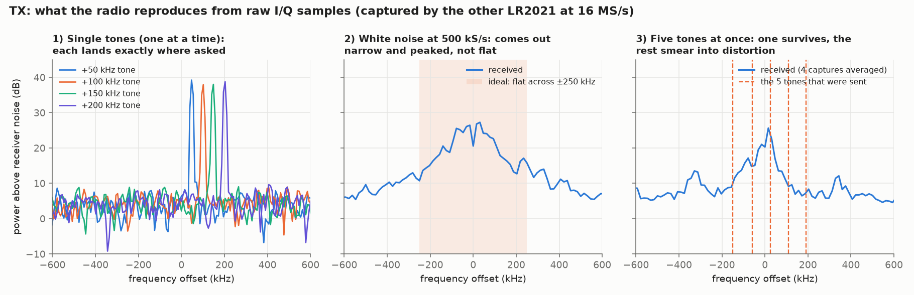
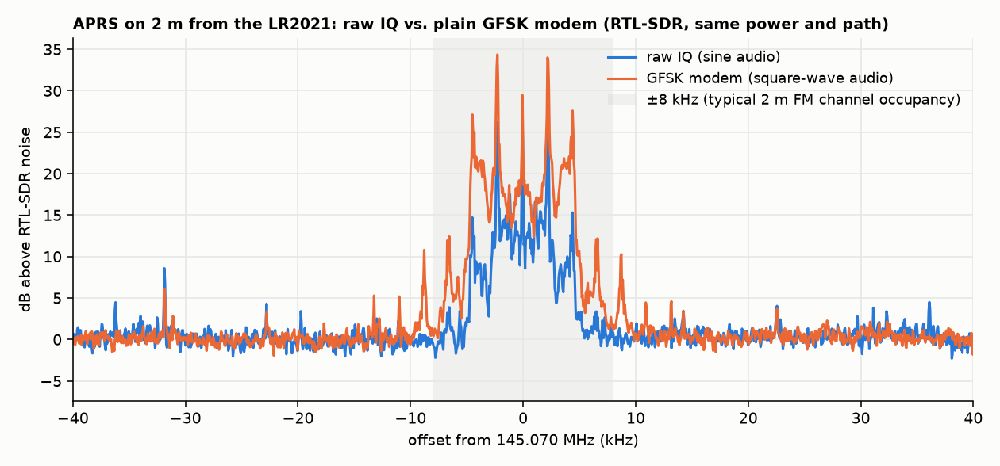

# LR2021 bit-rate bench (2026-10-30)

Firmware: `firmware/src/rate_bench` (envs `xiao_rate_bench`, `nicerf_rate_bench`). Host helpers:
`tools/bench/`.

**LoRa tops out at 118 kbps of delivered payload; FLRC reaches 2.08 Mbps.**

| Best case | PHY rate | On-air payload rate (measured) | Delivered goodput | Loss |
|---|---|---|---|---|
| LoRa SF5 / 1000 kHz / CR 4/5, 908 MHz | 125 kbps | 124.5 kbps | **118.3 kbps** | 0 / 1000 |
| FLRC 2.6 Mbps uncoded, 2478 MHz, 480 B | 2.6 Mbps | 2.60 Mbps | **2.08 Mbps** | 7% CRC fail |
| FLRC 2.6 Mbps CR 3/4, 2478 MHz, 480 B | 1.95 Mbps | | **1.73 Mbps** | 0.4% |
| FLRC 2.6 Mbps CR 3/4, 908 MHz, 255 B | 1.95 Mbps | | **1.56 Mbps** | 0.7% (at −100 dBm) |



## Setup

- TX: Seeed XIAO nRF52840 + Wio-LR2021 (`xiao_rate_bench`).
- RX: RAK3401 + NiceRF LoRa2021F33-2G4 carrier (`nicerf_rate_bench`).
- Dummy loads on both boards. Coupling is leakage only: at +20 dBm TX the RX sees −99 dBm at 908 MHz.
  At +12 dBm it sees −79 dBm at 2478 MHz.
- Fast path: raw SPI at 16 MHz, IRQ pin polled, both FIFOs moved to the 1 KB region
  (datasheet 5.3.3). The receiver stays in continuous RX and drains every complete packet
  from the FIFO. Every payload is checked byte for byte against a sequence-seeded pattern.
- Pipelined TX (`pipe 1`) writes the next packet into the TX FIFO while the current one is on air.
  Fallback mode is FS. The gap between packets is then 36–38 µs of SPI (ClearIrq + SetTx), down
  from 215 µs.
- "On-air payload rate" is the slope of SetTx→TX_DONE time against payload length (`toa`).
- "Goodput" counts only verified payload bytes at the receiver, from first to last packet.

## LoRa (908 MHz, Xiao +20 dBm, RX −99 dBm, SNR 7.9 dB)

SF5 / 1000 kHz / CR 4/5 / preamble 8 is the fastest LoRa setting on the LR2021 (datasheet: 125 kbps).

| len | SetTx→TX_DONE |
|---|---|
| 8 | 1519 µs |
| 128 | 9198 µs |
| 255 | 17359 µs (formula 17192 + ~0.17 ms ramp) |

Slope 64.3 µs/byte = 124.5 kbps.

| 1000 × 255 B | Goodput | Turnaround |
|---|---|---|
| explicit header | 116.1 kbps | 215 µs (FIFO write in the gap) |
| explicit, pipelined | 117.3 kbps | 38 µs |
| implicit header, pipelined | **118.3 kbps** | 38 µs |

There were no losses or CRC errors in any run.

## FLRC

Settings: 32-bit preamble, 32-bit sync, CRC-16, Gaussian BT 0.5. Payloads up to 511 bytes.
`toa` slope from 255 to 511 B is 3.074 µs/byte = **2.60 Mbps**. A 511 B packet is 1.78 ms on air.



### 2478 MHz (Xiao +12 dBm, RX −79 dBm)

| Coding | 255 B, pipelined | 480 B, pipelined | CRC fail |
|---|---|---|---|
| uncoded | 1.91 Mbps (TX offered 2.00) | **2.08 Mbps** (TX offered 2.24) | 4.4% / 7% |
| CR 3/4 | 1.58 Mbps | 1.73 Mbps | 0.3% / 0.4% |
| CR 1/2 | 1.11 Mbps | 1.19 Mbps | 0.4% / 0.6% |
| 2.08 Mbps uncoded | 1.53 Mbps | | 7.8% |

- Uncoded at TX +4 dBm (RX about −87 dBm): every packet failed CRC.
- Noise-floor sweep (`noise`, FLRC filter, no TX): about −93 dBm mean across 2400–2482 MHz.
  Wi-Fi channels 6 (2432–2444) and 11 (~2462) stand out. That floor is about 10 dB above
  thermal plus a typical noise figure, so −79 dBm leaves only ~14 dB of SNR. That's enough
  for coded FLRC but marginal for uncoded. The cause is unknown: it could be the NiceRF
  2.4 GHz FEM, board noise, or just the RSSI_inst reading floor. Swapping roles (NiceRF FEM
  TX into the Xiao) would separate these, but the NiceRF board needs a battery to transmit.
- At 480 B uncoded, the RX FIFO peaked at 954 of 1000 bytes. CRC-failed packets can carry a
  corrupted length, which knocks the receiver's fixed-length FIFO parsing out of step (259 resyncs).
  Goodput still counts only verified packets.

### 908 MHz (Xiao +20 dBm, RX −100 dBm: at the datasheet sensitivity)

| Config, 255 B pipelined | Goodput | Loss |
|---|---|---|
| 2.6 Mbps CR 3/4 | **1.56 Mbps** | 0.7% |
| 2.6 Mbps CR 1/2 | 1.11 Mbps | 0.5% |
| 1.3 Mbps CR 3/4 | 0.85 Mbps | 0 |
| 1.3 Mbps uncoded | 0.96 Mbps | 12.6% |
| 650 kbps uncoded | 0.58 Mbps | 0 |
| 2.6 Mbps uncoded | ~0.02 Mbps | ~99% (too weak) |

## Where the remaining overhead goes

- **LoRa 255 B:** 17.2 ms on air for 2040 payload bits. The fixed costs are a 14.25-symbol
  preamble (0.46 ms), the TX ramp (~0.17 ms) and the 38 µs gap: 95% efficient.
- **FLRC 2.6 Mbps uncoded, 255 B:** 984 µs on air against 785 µs of payload bits. That leaves
  ~200 µs per packet for TX ramp, preamble, sync, header and CRC, plus a 36 µs gap.
  Longer packets amortise it: 480 B gives 2.24 Mbps offered.
- 511 B packets can't be pipelined: two don't fit in the 1 KB TX FIFO.

## Reproduce

```
cd firmware
pio run -e xiao_rate_bench -t upload --upload-port <xiao port>
pio run -e nicerf_rate_bench -t upload --upload-port <nicerf port>
# tools/bench/portd.py logs each board and takes commands from a FIFO; sw.sh / link.sh drive a run
# both:  lora 1000 5 1 8 1 1 255        or   freq 2478 ; flrc 2600 2 7 1 2
# tx:    pwr 20 ; toa 20 8 64 128 255 ; tx 1000 255 1 0
# rx:    rx   ... x
```

## Reserved LoRa bandwidth codes (Semtech's "LoRa up to 200 kbps" claim)

Semtech's launch press release says "LoRa up to 200 kbps". Datasheet Rev 2.2 says 125 kbps,
and its bandwidth table (Table 9-3, a 4-bit code) tops out at 1000 kHz. The four codes marked
RFU were tried with `lora c<code> ...`. All were accepted without chip errors. Their airtime
(16 vs 64 B at SF5) shows they are the SX127x narrow bandwidths, not a wider one:

| Code | Airtime ratio to 1000 kHz | Bandwidth |
|---|---|---|
| 0x0 | 128.0× | 7.81 kHz |
| 0x8 | 96.0× | 10.42 kHz |
| 0x1 | 64.0× | 15.63 kHz |
| 0x9 | 48.0× | 20.83 kHz |

Two of them were received end to end: 0x9 and 0x0 at SF7 each got 10/10 16-byte packets,
RSSI −99.5 dBm, SNR 15.25 dB. 0x1 and 0x8 were only timed on the transmitter.
No setting gives LoRa above 125 kbps.

## Unlisted spreading factors (SF0–4) and the reserved LDRO value

Table 9-2 lists SF5–SF12. At 1000 kHz, SF4 with CR 4/5 would be exactly 4 × 1e6/16 × 0.8 =
200 kbps, the press-release figure, so the unlisted codes were tried. `lora` now takes two
optional arguments, `[ldro] [mode]`, sent as a raw SetLoraModulationParams (0x0220). This is
needed because RadioLib's auto-LDRO ignores the ldro argument it is given. The command prints
the chip's status, so you can see whether each value was accepted.

**What the ROM does.** Handler 0x0220 (ROM 0xF238) calls 0x9134. That function rejects SF ≥ 13,
bandwidth > 15, CR > 9 and ldro > 2. There is **no lower bound on SF**: SF0–4 are written
unchanged into register 0xF30A14[3:0]. The only SF-dependent step sets bit 18 when SF < 7
(the SF5/6 flag), so SF0–4 get that flag too. Whatever SF0–4 do comes from the modem hardware,
not the firmware.

Airtime (16-byte packet, 1000 kHz, CR 4/5, explicit header, CRC on):

| SF code | Airtime | What it is |
|---|---|---|
| 12 | 146 ms | normal SF12 |
| 4 | 297 ms | SF12-length chirps carrying 4 bits each |
| 3 | 359 ms | ~3 bits per chirp |
| 2 | 502 ms | ~2 bits per chirp |
| 1 | 912 ms | ~1 bit per chirp |
| 0 | 63 ms | preamble + sync + 2–3 empty chirps; no payload is sent |
| 13–15 | n/a | rejected (CMD_PERR) |

**"SF4"** was recorded on the RTL-SDR at 908 MHz (28 dB SNR):
- Each chirp sweeps 1 MHz in 4.096 ms, which is SF12 (4096 chips).
- The framing is normal: 8 upchirps, sync word (8, 16), 2.25 downchirps.
- The 655 payload symbols of a 255-byte packet use **only the values 0–15**, out of 4096, all
  about equally often. 655 = 645 (255 B + CRC at 4 bits per symbol, CR 4/5) + about 10 header
  symbols.
- Airtime doubles at 500 kHz.
- The chip can't receive it back. The NiceRF set to SF4 saw nothing, and an SF12 receiver
  detects the preamble and then raises a header error.
- The standard LoRa decoding steps run at SF4 don't recover the payload, whatever symbol
  offset, Gray mapping or header layout is used. The modem uses some other bit mapping for SF < 5.

**"SF0"** has a fixed 62.6 ms airtime for 1–128 bytes at any coding rate, and 58.5 ms at
255 bytes. The few chirps after the downchirps all have value 0. The modem's symbol count
divides by SF, so 0 bits per chirp go out. An SF12 receiver sees a preamble and a header error.
In effect it is a constant-length LoRa "ping" carrying no data.



**ldro = 2.** The datasheet defines ldro 0/1 and calls 2–3 RFU. The ROM accepts 2 and rejects 3.

| ldro | Symbol values used (RTL-SDR) | Bits per chirp at SF12 | Airtime per byte | Link (same setting) |
|---|---|---|---|---|
| 0 | all | 12 | 3.41 ms | 6/6 |
| 1 | multiples of 4 | 10 | 3.84 ms | 6/6 |
| 2 | multiples of 8 | 9 | 4.70 ms | 6/6, −92.5 dBm, SNR 8.8 dB |

ldro=2 is a stronger LDRO: SF−3 bits per chirp, so a symbol can drift ±4 values (instead of
±2) before it's misread. It doesn't interoperate with ldro=1 in either direction (CRC errors
or nothing). It could help with very long symbols, such as SF12 at the 7.8–20.8 kHz bandwidths
above.

**The hidden mode field.** Bits 3:2 of byte 2 (marked rfu) go to 0x9134 as a 2-bit field.
- Its default depends on the bandwidth code: 0 for codes 0x0–0xB, 2 for 0xC, and 1 for
  0xD–0xF, the SX1280-compatible bandwidths.
- It changes only registers 0xF3013C, 0xF30150 and 0xF30134, in the receive/AGC block.
- All four values are accepted. At SF7 / 1000 kHz they don't change airtime, and every
  TX/RX combination received 20/20.
- It probably tunes the receiver. Showing an effect would need a sensitivity sweep with a step
  attenuator.

## Packet type 0x01 (RFU): an empty slot

Packet type 0x0B, also "RFU", turned out to be raw IQ, so 0x01 was checked the same way. The
new raw commands `rc` and `rr` send any write or read command and print the chip's status;
`ptx <len> <ms>` sends one packet without touching the modem setup.

**ROM.** SetPacketType (0x0207 → 0xF7E4 → 0xF710) accepts 0x0–0xD and runs a per-type
initialisation from a jump table. **For type 1 the entry jumps straight to the exit:** no modem
is set up. Two other places know about type 1:
- The status getter at 0x5CB2 puts it in the generic packet-engine group, with FSK, BLE,
  WM-BUS, Wi-SUN, OOK, Z-Wave and O-QPSK (bitmask 0x370E).
- The RX statistics routine at 0x112D8 gives it 3 counters (FSK has 7).

It looks like the slot of a removed modem that still points at the shared packet engine.

**On air** (Xiao, 908 MHz, +20 dBm into the dummy load, recorded on the RTL-SDR):
- **Accepted:** SetPacketType(1) returns CMD_OK, and GetPacketType reads back 1.
- **After a LoRa setup:** every packet (1–511 bytes) takes exactly 8.6 ms and raises TxDone.
  The signal is an **unmodulated carrier** at 908.000 MHz (frequency spread 42 Hz rms, which
  is noise).
- **After an FSK setup** (50 kbps, ±25 kHz, 32-bit preamble, 64 bytes): type 1 takes the same
  airtime as FSK (11,620 µs both) and sends the **same bits**. All 582 demodulated bits match
  the FSK packet: preamble, sync word and payload.

Type 1 has no modulation of its own. It leaves whatever the previous modem set up in place, and
the generic packet engine sends with it. Nothing hidden here. Receive in type 1 wasn't tested.

## Raw IQ: RX vs TX bandwidth

Commands:
- `iqtx` (raw TX): plays I/Q samples through the undocumented command 0x0293, with the TX
  FIFO fed from MCU RAM. The method follows [lr2021-sdr](https://github.com/SAMS0N1TE/lr2021-sdr)
  (`src/lr2021_iq_tx.c`): OOK packet type, 1 KB TX FIFO, 896 B prefill, refill at ≤ 768.
- `cap` (raw RX): one-shot 8 KB capture into chip RAM (0x0290, packet type 0x0B).

Setup: 908 MHz, Xiao +20 dBm, about −100 dBm at the NiceRF.

### RX: the radio captures far more than the bus can carry

Rates were measured with known TX tones, from the phase slope of each capture.
Capture bytes are 32-bit words; reverse each word to get I0 Q0 I1 Q1.

| LoRa BW setting | Capture rate |
|---|---|
| 62.5 kHz | 0.25 MS/s (4×) |
| 125 kHz | 2.0 MS/s (16×) |
| 250 kHz | 4.1 MS/s (16×) |
| 500 kHz | 7.9 MS/s (16×) |
| 1000 kHz | ~16 MS/s (16×) |

16 MS/s of int8 I/Q is 32 MB/s into chip RAM. SPI at 16 MHz carries at most 2 MB/s.
Streaming RX is limited by the bus and the MCU (see [raw-iq.md](raw-iq.md)): continuous
500 KB/s worked, and 1 MB/s overflowed on the nRF52.



### TX feed rate (nRF52, 16 MHz SPI, 32,767-pair bursts)

| Rate | Burst time (expected) | FIFO low point | Result |
|---|---|---|---|
| 125 kS/s | 263.4 ms (262.1) | 733 B | clean |
| 250 kS/s | 132.3 ms (131.1) | 697 B | clean |
| 500 kS/s | 66.8 ms (65.5) | 461 B | clean |
| 600 kS/s | 55.9 ms (54.6) | 284 B | clean |
| 700 kS/s | | 76 B | underflow (flag 0x20), 61 of 64 KB loaded |
| 1 MS/s | | 0 | underflow, 44 of 64 KB loaded |

The nRF52 can feed about 600 kS/s (1.2 MB/s). 1 MS/s needs 2 MB/s, which is all of a
16 MHz SPI bus. lr2021-sdr reaches 1 MS/s at 26.67 MHz SPI, which is above the datasheet limit.



### TX: what the radio reproduces

- **Single tones:** at 500 kS/s, tones at +50, +100, +150 and +200 kHz come out at the right
  frequency and within 1.3 dB of each other.
- **White noise** (random phase every sample, constant envelope):
  - at 125k, 250k and 500k S/s the spectrum has the same shape: −3 dB at about ±80 kHz,
    −10 dB at ±170 kHz;
  - 1 MS/s short bursts are no wider in the main lobe (−3 dB ±47 kHz);
  - phase jumps get smoothed and don't turn into bandwidth.
- **5-tone signal** (+25, −60, +110, −150, +190 kHz, so the amplitude varies), 500 kS/s:
  - the +25 kHz tone dominates;
  - the others come out 9–29 dB down;
  - unwanted components are only 4–6 dB below the strongest tone;
  - it's the same at peak amplitude 56 and 25, so it isn't saturation.
- lr2021-sdr reports smooth constant-envelope chirps up to 1 MS/s with 97–99% of the
  power in the dechirped line.



### Why raw TX only works for FM-type signals

There are two ways to build a transmitter:

```
SDR-style (HackRF, USRP):
  I -> DAC -\
             mixer (x LO) -> linear amplifier -> antenna   any complex waveform
  Q -> DAC -/

LR2021 (like most IoT radios):
  frequency word -> synthesizer (PLL) -> saturated amplifier -> antenna
                    "carrier at f0 + delta-f"               one carrier at a time
```

The datasheet's first line says the LR2021 "handles various constant envelope modulation
schemes" (LoRa, (G)FSK, MSK, FLRC, O-QPSK), plus OOK. Section 1.6 describes the synthesizer's
"2-point modulation", which widens how fast the PLL can be frequency-modulated. A saturated PA
is very efficient, which is how the chip reaches +22 dBm on little current. The cost is that
it can't reproduce a varying envelope. Amplitude only reaches the PA through the OOK on/off
path, which is coarse.

Raw I/Q has to be turned into something the synthesizer accepts. Most likely each sample's angle
is taken, and the change in angle from one sample to the next becomes a frequency. That is
inferred from the measurements and the architecture, not read from the ROM. lr2021-sdr also
found that 0x0293 accepts frequency or phase-increment samples directly, a hint that frequency
is the native input.

- **Tone**: the angle advances by the same amount every sample, so the frequency is constant.
  The synthesizer parks there. Measured: perfect, out to ±200 kHz.
- **Chirp**: the frequency changes smoothly and the PLL follows. lr2021-sdr measured 97–99%
  of the power in the dechirped line.
- **White noise**: each sample jumps up to half a turn, so the requested frequency leaps
  across ±rate/2 on every sample. The loop can't follow and smooths it toward the centre. A
  half-turn jump is also ambiguous (up or down).
- **Several tones at once**: the sum swells and nearly cancels. Its angle spins wildly at the
  near-zeros. It has to be split into a frequency path that can't follow the spins and an
  amplitude path that barely varies, and the errors show up as distortion.

Analogy: the LR2021 transmitter is a singer and an SDR is a piano. It can hold any note and
glide between notes, but it can't sing a chord.

For general-purpose I/Q, **TX is limited by the radio**, well inside what the bus can feed.
For FM-like signals (tones, FSK, chirps) the bus is the limit: ~600 kS/s on this nRF52.
**RX is limited by the bus** everywhere: the receive path really does digitise I and Q.

Caveats:
- one capture is 256 µs (4096 samples at 16 MS/s);
- the capture's own response was not calibrated separately;
- one TX board;
- the 1 MS/s white-noise bursts had FIFO underflows.

## How low can it tune? (receive only, nothing transmitted)

`pll <MHz ...>` tunes the NiceRF board's receiver, runs front-end calibration, enters RX,
and reads the chip's error flags. Nothing was transmitted below 902 MHz.

| MHz | SetRfFrequency | CalibFE | Error flags |
|---|---|---|---|
| 908, 432.3, 222, 150 | ok | ok | none |
| 144.489, 130, 120, 110, 102 | ok | ok | none |
| 101, 100.5 | ok | **fail (−707)** | 0x0280: IMG_CALIB_ERR + RXFREQ_NO_FE_CAL_ERR |
| 99.9, 90 … 40, 28.1, 14.1 | **rejected (−706)** | fail | 0x0280 |

- The synthesizer's floor is 100 MHz, and calibration works down to about 102 MHz.
- The datasheet specifies 150–960 MHz, and lr2021-sdr reports 100 MHz.
- No PLL lock errors were seen on any accepted frequency.
- "No error" doesn't mean it works well. Both boards' RF matching is designed for 900 MHz,
  so sensitivity and output power at 144 MHz are unknown.

### WSPR and FT8

Both are constant-envelope FSK, the kind of signal this transmitter reproduces well:

| Mode | Tones | Spacing | Length | Bandwidth |
|---|---|---|---|---|
| WSPR | 4-FSK | 1.46 Hz | 110.6 s | ~6 Hz |
| FT8 | 8-FSK (GFSK) | 6.25 Hz | 12.64 s | ~50 Hz |

- **HF (20 m, 10 m): not possible directly.** Below 100 MHz the chip refuses to tune. It
  would need an external mixer or transverter, and at that point a Si5351 clock chip is the
  usual cheaper route.
- **2 m (144 MHz), 1.25 m (222 MHz), 70 cm (432 MHz): plausible.** Generate a
  phase-continuous tone sequence with `iqtx` at a low sample rate.
  - One 0x0293 burst holds at most 32,767 samples. A whole WSPR transmission therefore needs
    ≤ 296 S/s, and FT8 ≤ 2,592 S/s.
  - lr2021-sdr measured rates from 4,800 S/s. Lower rates are listed as valid but untested.
  - Alternative: hold a carrier and retune per symbol. The frequency command takes whole Hz,
    which is coarse next to WSPR's 1.46 Hz spacing.
- **Frequency stability is the risk for WSPR.** It needs less than about 1 Hz of drift over
  110 s. At 908 MHz the boards' offset wandered ~80 Hz over a session, about 13 Hz at
  144 MHz. FT8 tolerates much more.
- **Receive** is the easier half. Continuous raw-IQ streaming at the 62.5 kHz setting
  (250 kS/s, decimated to 83 kS/s for the PC) could be decimated to 12 kS/s, demodulated
  as USB, and fed to WSJT-X.
- Transmitting on amateur bands needs an amateur licence (in the US, Technician or higher
  for 2 m and 70 cm). Nothing was transmitted there for this report.

### On-air tests at 2 m and 70 cm (licensed operator, callsign shown as N0CALL; 0 dBm into dummy loads)

Method: the Xiao plays a tone with `iqtx` at 2,400 S/s. The NiceRF streams IQ continuously with
`iqstream` (83.3 kS/s after 3× decimation), recorded by `tools/bench/rec.py` using the LRIQ parser in `tools/iq_stream.py`.

| TX | RX | Result |
|---|---|---|
| 432.175 MHz, +200 Hz tone, 10 s | 432.1753 MHz | received, 27 dB above noise (0.125 Hz bins); clean 10.001 s burst |
| 144.1753 MHz, +200 Hz tone | 144.1753 MHz | **nothing**, even with 8 s coherent integration |
| 144.1753 MHz, +200 Hz tone | 432.5259 MHz (3rd harmonic) | **received**, 29 dB above noise |

- **2,400 S/s raw TX works.** A whole FT8 message (12.64 s) fits in one burst
  (30,336 ≤ 32,767 samples).
- **The Xiao transmits at 144 MHz** (below the 150 MHz datasheet floor), shown by its 3rd harmonic.
  **The NiceRF board doesn't receive there.** Unknown whether it's the module's 915 MHz front end
  or the LR2021's LF receiver below 150 MHz.
- **Harmonics:** the Xiao's 3rd harmonic from 2 m was as strong at the receiver as a 70 cm
  fundamental at the same drive. Both modules filter for 900 MHz, so 432 MHz passes. On an
  antenna, 2 m operation would need an external low-pass filter to meet FCC §97.307.
- The boards' crystals differ by ~0.36 ppm (157 Hz at 432 MHz).
- **TX timeout fix:** SetTx timeout ticks are 32.768 kHz. lr2021-sdr's `ticks = us*32/1000`
  runs 2.3% short. Its 50 ms margin hides that on short bursts, but it cut a 10 s burst at 9.815 s.
- `tools/bench/iq2wav.py` turns a recording into 12 kHz USB audio for WSJT-X. A tone test gave 1,347 Hz
  audio at 44 dB above the median.

## APRS (AX.25 over AFSK 1200 on FM) from raw IQ

APRS is FM, which this transmitter reproduces well.
- `tools/bench/aprs.py` builds AX.25 UI frames (HDLC stuffing, NRZI, CRC-16/X.25) and decodes them
  from an IQ recording: channel filter, FM discriminator, AFSK tone detector, clock recovery.
- The firmware's `afsk` command loads the tone bits.
- `iqtx 38400 <pairs> a 3.0 ...` frequency-modulates the carrier (±3 kHz deviation,
  phase-continuous 1200/2200 Hz audio, 32 samples per bit).
- A 24-character status frame is 689 tone bits, 0.58 s on air.
- Test frame: `N0CALL>APZ001:>LR2021 raw IQ APRS test`. APZ is the experimental tocall. No
  position and no digipeater path.

| TX | RX | Result |
|---|---|---|
| NiceRF, 908 MHz, lowest drive | Xiao, 908 MHz | **decoded, CRC valid** (burst power 49 vs 11 noise) |
| Xiao, 145.07 MHz, 0 and +22 dBm | NiceRF, 3rd harmonic at 435.21 MHz | not decoded. The harmonic is only ~1 dB above noise in the FM bandwidth even at +22 dBm (dummy-load coupling) |
| NiceRF, 145.07 MHz, drive −9 / 0 / +7 | Xiao at 145.07 and at 435.21 MHz | nothing detected at all |

- The whole chain works (encode → raw-IQ FM → stream → decode).
- On 2 m, the Xiao transmits but its signal coupled through the dummy loads is too weak to
  demodulate. The NiceRF board puts out nothing detectable at 145 MHz: its PA and matching are
  built for 868/915 MHz.
- The Xiao's receive at 145 MHz is untested: there was no working 2 m source to test it with.
- Going on air on 144.390 MHz would mean: the Xiao on an antenna, an external 2 m low-pass filter
  (its 3rd harmonic passes the module's 900 MHz filtering), at most +22 dBm nominal (output below
  150 MHz is unmeasured), and a digipeater or iGate within range.

### 2 m APRS received by an RTL-SDR

Setup: Xiao at 145.070 MHz → junk-box filter → dummy load. The receiver is an RTL-SDR Blog V4
at 240 kS/s, tuned 50 kHz low, max gain. `aprs.py decode_rtl <file> 240000 50000`.

| Xiao power | Result |
|---|---|
| 0 dBm (RTL gain 30) | burst barely visible, not decoded |
| +22 dBm (RTL gain 49.6) | **decoded, CRC valid**: `N0CALL>APZ001:>LR2021 raw IQ APRS test`, ~11 dB above noise in channel |

So the Xiao's LR2021 does produce a working 2 m FM APRS signal (below the 150 MHz datasheet floor).

Harmonic check, same leakage path, uncalibrated, 5 s tone: the 3rd harmonic (435.21 MHz) read
**29 dB stronger** than the fundamental. This is not a conducted measurement. Board/shield
radiation bypasses the filter and dummy load, and the RTL antenna's response differs by band.
The number says nothing about filter performance or §97.307 compliance. To check that, measure
conducted: Xiao → filter → 40–60 dB attenuation → RTL-SDR, with and without the filter.

### On 144.390 MHz: a Kenwood received and acknowledged it

Setup: Xiao at +22 dBm → filter → dummy load; no digipeater path, no position. RTL-SDR recording 20 s.

```
N0CALL-1>APZ001::N0CALL   :LR2021 raw IQ test{1      sent: LR2021 raw-IQ AFSK/FM
N0CALL>APK003,WIDE1-1::N0CALL-1 :ack1                the operator's Kenwood's automatic ack
```

- A standard APRS radio decoded the LR2021's raw-IQ FM packet and returned an ack.
- Both frames were also decoded from the RTL-SDR recording.
- Earlier status/bulletin packets sent as `N0CALL` were sent fine (the status one was confirmed
  on the RTL-SDR), but the Kenwood ignored them because they carried its own callsign. Use a
  different SSID as the source.

### APRS without raw IQ: the GFSK modem as a 1-bit FM "DAC"

`fskafsk <bps> <dev> <shape> <msb>` sends the loaded AFSK bits through the documented GFSK packet
modem. No undocumented commands are involved.
- Each modem bit sets the carrier to +dev or −dev.
- The bits are a square wave at the AFSK tone: bit = sin(audio phase) ≥ 0.
- At 26,400 bps one AFSK bit is 22 modem bits: 1200 Hz is 11 + 11 bits, 2200 Hz is 6 + 6.
- Preamble 0, no sync word, no CRC, no whitening, fixed length, MSB first.
- The payload (1,983 bytes for a 28-character status) is streamed through the 1 KB TX FIFO.

| Setting | Result (RTL-SDR, 145.070 MHz, Xiao +22 dBm → filter → dummy load) |
|---|---|
| 26,400 bps, ±3 kHz, Gaussian BT 0.5, MSB first | **decoded, CRC valid**: `N0CALL-1>APZ001:>LR2021 GFSK-modem APRS test` |
| same, LSB first | not decoded: the bit order scrambles the tones |



Spectrum:
- 99% occupied bandwidth is 13.7 kHz.
- The square wave adds lines out to about ±13 kHz, 20–30 dB below the main tones; the raw-IQ
  sine version doesn't have them.
- The raw-IQ burst's 99% figure isn't meaningful (lower SNR).
- The GFSK burst arrived about 8 dB stronger at the same power setting, probably because raw IQ
  at sample magnitude 50 doesn't drive the PA fully (inferred).

Receiving APRS still needs raw IQ: the GFSK demodulator can't see AFSK audio tones, and the chip
has no FM audio output.
